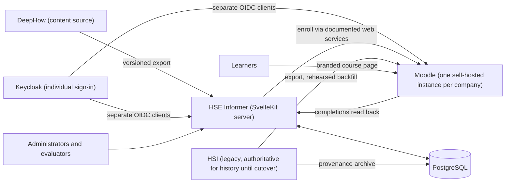

# Refactor 001: Preview to DeepHow, Moodle, and SvelteKit

| | |
|---|---|
| **Status** | Implementation underway. Live integration, regulatory, and cutover gates remain pending. |
| **Scope** | Architecture, contracts, implementation milestones, and release gates. |
| **Supersedes** | Nothing yet. The React/Vinext preview stays as a reference until the SvelteKit replacement reaches parity (Phase 2). |
| **Builds on** | [Product direction](vision/phases.txt), [contract register](contracts/README.md), [starter requirements](requirements/starter-records.md) |
| **Progress** | [Implementation ledger](refactor-001-progress.md) records checked-in work and open gates. |

## 1. Purpose

HSE Informer is moving from a browser-only administrator preview to a production training-management system:

- **DeepHow** supplies course content.
- **One self-hosted, unmodified Moodle instance per client company** delivers courses and records new enrollments and completions. Site cohorts represent facilities within that company.
- **Self-hosted Keycloak** gives each worker an individual sign-in and can broker employer identity providers later.
- **HSE Informer** (`web/`, Svelte 5 / SvelteKit on PostgreSQL) decides who must be trained, why, and when. It also holds the evidence that turns a course completion into a workplace authorization.

The [product direction](vision/phases.txt) still governs. Specifically:

1. **Applicability first.** Assignments come from site, job, task, equipment, chemical, and exposure rules. HSE Informer never assigns every course to every employee.
2. **Immutable evidence.** Each record keeps the exact course version, site addendum version, assessment, evaluator, and dates that applied when the training happened. HSE Informer never repoints an old record at new content.
3. **Knowledge completion is not authorization.** A Moodle completion means **Knowledge Complete** and nothing more. **Site Training Complete**, **Practical Evaluation Passed**, **External Credential Verified**, and **Authorized / Qualified** are separate states that HSE Informer owns.

## 2. Current state

The repository has one application, [`admin-app`](../admin-app/README.md). It is a React 19 app on Vinext `1.0.0-beta.5`, hosted as a private preview through Sites/Cloudflare.

**None of its data is authoritative:**

| Preview element | Where it lives | Status after this refactor |
|---|---|---|
| Organizations, three fictional sites (North Plant, Riverbend Facility, West Works), learners, and assignments | Seed data in [`training.ts`](../admin-app/lib/training.ts#L1-L12) and [`training.ts`](../admin-app/lib/training.ts#L156-L240) | Discarded. Never migrated into PostgreSQL, Moodle, or reports. |
| Assignment edits | Browser `localStorage` under `hse-informer-admin-preview-v1` ([`training-workspace.tsx`](../admin-app/components/training-workspace.tsx#L350-L392)) | Replaced by server-owned PostgreSQL records in Phase 2. |
| Fixed reporting date `2026-09-09` | [`training.ts`](../admin-app/lib/training.ts#L1) | Replaced by real time plus testable clock injection. |
| Five draft courses (Respiratory Protection, Lockout/Tagout, Confined Space, Chemical Hygiene, Hazard Communication) with 48 lesson titles and one draft opening lesson | [`training.ts`](../admin-app/lib/training.ts#L30-L155), [`respiratory-lesson-content.tsx`](../admin-app/components/respiratory-lesson-content.tsx) | Reference syllabi only. These are not approved course versions and will not be published as courses. Production content comes from DeepHow. |
| Learner theme preference (`hse-learner-theme`) | Browser `localStorage` | May stay device-local. It is a display preference, not a record. |

The preview gets these things right, and the new system must keep them: completion and authorization stay separate, statuses don't overlap (Overdue takes precedence), assignment reasons are explicit, open assignments aren't duplicated, and recurrence is labeled as planning metadata. The [admin-app README](../admin-app/README.md) lists the features that make up the parity checklist used in Phase 2.

## 3. Target architecture and data ownership

Each record type has exactly one system of record:

| Record | System of record | Notes |
|---|---|---|
| Course content and content versions | **DeepHow** | HSE Informer stores a mapping from each DeepHow content ID and version to a Moodle course or activity ID, plus a package checksum. |
| Assignment decision (person, requirement, reason, due date, triggering rule or event) | **PostgreSQL** | HSE Informer decides; Moodle carries out the decision as an enrollment. |
| New LMS enrollments | **Moodle** | Created only by HSE Informer's server-side integration. Manual enrollments are detected and reported. |
| New knowledge completions (status, time, score, attempts) | **Moodle** | HSE Informer reads them back and attaches the course version and site context that applied at the time. |
| Historical (pre-cutover) completions | **HSI** until Phase 4 reconciliation passes, then **Moodle** | Provenance (HSI record ID, original dates, export checksum, import batch) is kept in PostgreSQL. |
| Tenants, sites, and tenant/site ↔ Moodle mappings | **PostgreSQL** | One Moodle instance per company; Tifton, Ocilla, and Vernon are initial site cohorts inside the first company's instance. |
| Requirements, applicability rules, recurrence rules, retraining triggers | **PostgreSQL** | Structure follows phases.txt Phase 0. |
| Site addenda and their versions | **PostgreSQL** (version register) | The delivery mechanism (a Moodle activity or HSE Informer itself) is decided in Phase 3. The version is recorded either way. |
| Practical evaluations, evaluator qualifications, checklists, attestations | **PostgreSQL** | |
| External credentials (CPR/AED and similar) | **PostgreSQL** | |
| Authorization records and restrictions | **PostgreSQL** | Never set by a Moodle completion alone. |
| Login credentials and sessions | **Keycloak** | Individual accounts for workers without company logins. HSE Informer and Moodle are separate clients; person identity is an HSE-generated stable ID. |
| Confidential medical data (respirator questionnaires, audiograms) | **Not stored** | Only clearance status and date, per phases.txt. |

The binding [domain/evidence contract](contracts/domain.md) names the identifiers, permissions, status guards, and evidence envelope. The [integration contract](contracts/integrations.md) specifies the candidate Moodle function allowlist, Keycloak/course launch, DeepHow intake, retries, reconciliation, and the unverified HSI inventory.

## 4. Phased refactor

Every phase ends with an **exit criterion**: a result someone can observe or reproduce. Writing a document, or saying the work is done, does not count. A **gate** is a fact that must be verified before later work depends on it. If a gate fails, the dependent work stops and the plan is revised in this document.

### Phase 0: Compliance and data contracts

**Objective.** Define the implementable contracts before depending on external integrations. Drafts can support synthetic tests; they cannot authorize production assignments.

**Work.**

- **Requirement records.** [Draft the five preview topics](requirements/starter-records.md) with authority, legal-status label, applicability, audience, delivery, recurrence, triggers, records, and site overlays. Mark every record **UNAPPROVED** until a qualified HSE reviewer verifies it; do not invent a citation or activate an unapproved rule.
- **Status vocabulary.** Adopt the five states from phases.txt §1 and specify which system can move a record into each state.
- **Ownership.** Adopt the ownership table in §3 and the [domain contract](contracts/domain.md).
- **Identifiers.** Generate a stable HSE `person_id`; map Keycloak issuer/subject, HSI ID, and Moodle user ID as external identifiers scoped to the company and instance. Map DeepHow content/version/checksum to Moodle course/activity IDs without overwriting an older version.
- **Integration contracts.**
  - A candidate allowlist of documented Moodle web service functions; verify payloads and permissions against the exact deployed instance.
  - A DeepHow intake contract, with its actual export format left pending Gate A.
  - An [HSI field-inventory template](contracts/integrations.md#hsi-field-inventory-template), explicitly awaiting a real sample export.
- **Evidence schema.** Fields for immutable evidence, using phases.txt §5 "Audit-ready records" as the minimum.

**Exit criterion.**

- The [contracts](contracts/README.md) and five **UNAPPROVED** starter records are committed under `docs/`, and synthetic fixtures/tests conform to them.
- Before any production assignment, a named qualified HSE owner approves each legal-status label, source, applicability and recurrence rule, delivery/evidence requirement, and site overlay. This approval is **pending**.
- Before HSI migration mapping, every populated inventory row traces to a real HSI sample-export column. This export is **not yet available**.

### Phase 1: One DeepHow-to-Moodle course flow, with tenant isolation

**Objective.** Prove the delivery path end to end for one course before scaling.

**Work.**

- **HSE foundation prerequisite.** Create `web/` with Svelte 5/SvelteKit/TypeScript, a minimal Node server, PostgreSQL and versioned schema/migrations before attempting the end-to-end pilot. Use synthetic people and site fixtures only; no preview record becomes production evidence.
- **Moodle.** Stand up one unmodified self-hosted Moodle instance per test company outside production. Target 5.3 LTS, pin an exact patch/revision after tests, and create separate site cohorts for Tifton, Ocilla, and Vernon in the first company.
- **Identity and course launch.** Stand up self-hosted Keycloak with separate HSE Informer and Moodle OIDC clients. Provision an individual worker account without a company login, map it by HSE `person_id`, and launch the learner to a branded Moodle course page.
- **Pilot course.** Choose one with the HSE owner. Respiratory Protection is the default because it is the furthest-along preview course and has practical and fit-test components that test the completion/authorization split.
- **Gate A (DeepHow format).** Get a real DeepHow export of the pilot course and record what it actually is (for example SCORM 1.2, SCORM 2004, xAPI/cmi5, video files, or an LTI/link launch).
  - Moodle's native SCORM player supports **SCORM 1.2** ([SCORM FAQ](https://docs.moodle.org/500/en/SCORM_FAQ)). Do not assume a SCORM 2004 package will track correctly.
  - If the export isn't SCORM 1.2, choose and document another delivery path, such as LTI or URL launch with a separate completion source, before continuing.
- **Gate B (Moodle completion behavior).** Using the pilot course, verify:
  - which completion criteria fire;
  - the recorded `timecompleted`;
  - score and attempt retention;
  - what re-enrollment, course reset, and content-version replacement do to existing records;
  - how HSE Informer reads completions using only documented web services ([API functions](https://docs.moodle.org/dev/Web_service_API_functions)).
- **Tenant isolation.** Company isolation is by separate Moodle instances plus tenant-scoped HSE data; site cohorts are organizational groupings inside one company, not tenant boundaries. Create two test companies and cross-company tests for Moodle UI/web services and the HSE Informer API; also test site-scoped administrator grants.

**Exit criterion.**

- A test learner mapped to Tifton is enrolled through the HSE Informer server, completes the real DeepHow-sourced pilot course on a Moodle course page, and the completion is read into PostgreSQL. The record includes source completion time, available score/attempt data, Moodle course ID, and DeepHow content version; unavailable vendor fields are explicit.
- The record shows **Knowledge Complete** and **not authorized**.
- An automated test shows a tenant-B account cannot read tenant-A users, enrollments, or completions through Moodle or HSE Informer.
- Gate A, Gate B, exact Moodle patch, and the Keycloak account-linking result, with evidence, are recorded in this document. A synthetic SCORM test can prove the plumbing but does not pass the DeepHow gate.

**Synthetic infrastructure evidence (2026-10-11).** The development fixture pins the official Moodle **5.3.0** archive by SHA-256 (`7e5edf110555956571f40e42acffde0eb23681ebebd212a2fec0fe7d795dd511`). In [hosted CI run 38167948532](https://github.com/gibsondevhouse/hse-informer/actions/runs/38167948532), two instances installed and served their login pages. Three Keycloak issuers responded; synthetic workers authenticated only to their own company realms; and each Moodle web-service probe token was rejected by the other company's instance. This is a fixture smoke test, not Gate A or B: SCORM import/tracking, actual Moodle OAuth account linking, enrollment/completion round trips, and the real DeepHow pilot remain unverified. The pinned release is not yet accepted as the pilot's tested patch.

### Phase 2: SvelteKit alongside the preview; server-owned data

**Objective.** Replace browser-local state with server-owned records in the new stack, without disrupting the reference preview.

**Work.**

- **Expand `web/`.** Build the admin and learner experience on the Phase 1 SvelteKit foundation, next to `admin-app`.
- **Server-side access.** Data access, Moodle tokens, and DeepHow credentials stay in server load functions and actions and never reach the browser.
- **Database.** Extend the Phase 1 PostgreSQL schema and migrations for the full Phase 0 contracts.
- **Access control.** Add authentication, server-enforced tenant and site permissions, and audit logging of administrative changes.
- **Data replacement.**
  - Replace the `localStorage` assignment store with PostgreSQL records.
  - Replace the fictional sites with tenant-scoped Tifton, Ocilla, and Vernon site records. Learner data stays synthetic outside production.
- **Port the preview.** Port the admin features listed in the [admin-app README](../admin-app/README.md) as a parity checklist.
- **Freeze the preview.** `admin-app` gets no new features. It stays runnable as a visual and behavioral reference.

**Exit criterion.**

- Every item on the parity checklist passes in the SvelteKit app against PostgreSQL.
- Two administrators on different devices see the same assignment edit without reloading local state.
- A repository search finds no `localStorage`/`sessionStorage` use for training records in the new app; display preferences are exempt.
- The Phase 1 cross-tenant tests run in CI against the SvelteKit server and pass.
- An assignment made in the SvelteKit app creates the matching Moodle enrollment.

### Phase 3: Site addenda, evaluator signoff, recurrence, audit reporting, new dashboard

**Objective.** Build the compliance layer that makes HSE Informer more than a video library (phases.txt §3).

**Work.**

- **Site addenda.** Versioned addenda for Tifton, Ocilla, and Vernon. Each completion and authorization references the addendum version in force.
- **Evaluator signoff.**
  - Evaluator qualification records.
  - Versioned practical checklists.
  - Results, restrictions, and employee and evaluator attestations.
  - Only qualified evaluators can sign.
- **Recurrence and reassignment in HSE Informer.**
  - Recurrence follows per-requirement rules: annual, at-least-every-three-years, or event-driven. There is no blanket annual expiry.
  - Event triggers (new chemical, PPE or procedure change, duty change, observed deficiency) create assignment decisions, which then create Moodle enrollments.
  - Moodle is not the source of recurrence.
- **Authorization.** Computed from current prerequisites: knowledge completion, site training, practical evaluation, medical or fit-test clearance status, and approvals. Shown with restrictions.
- **Audit reporting.** A per-person, per-requirement evidence packet that reproduces the exact versions, dates, evaluators, and provenance.
- **New dashboard.** Replaces the preview dashboard using the five-state vocabulary, so it never shows a single "Certified" status.

**Exit criterion.** All of the following are shown with automated tests and a recorded demo:

- In a practical course at one site, a learner shows **Knowledge Complete — Not Authorized** until a qualified evaluator's signoff is recorded, and only then becomes **Authorized**.
- An unqualified evaluator's signoff is rejected.
- A procedure-version change at Ocilla creates reassignments and Moodle enrollments for exactly the affected people.
- A time-shifted test produces the next annual and three-year assignments on the expected dates.
- Publishing a new course or addendum version leaves existing records byte-identical.
- An audit packet for a test learner matches the underlying records field by field.

### Phase 4: HSI migration rehearsal, reconciliation, cutover

**Objective.** Move historical training records out of HSI without losing original dates or provenance.

**Gate C (historical import).** Moodle's documented web services do not provide a general way to write a completion with an arbitrary historical date ([API functions](https://docs.moodle.org/dev/Web_service_API_functions)). Before any rehearsal, build and test a reviewed one-time importer as an isolated Moodle extension, then record its exact behavior here:

- A one-time local plugin or supported extension point is allowed after code, security, and GPL review. It must preserve original HSI dates and record IDs and remain disabled after migration. Moodle core files remain untouched.
- Direct edits to Moodle core tables are prohibited. The importer must use supported Moodle APIs, provide a dry run and rollback plan, and fail closed on ambiguous mappings.

> [!CAUTION]
> **HSI cutover is blocked** unless original HSI completion dates and provenance survive a tested Moodle backfill and pass reconciliation. Until then, HSI stays authoritative for historical records, and nothing is decommissioned.

**Work.**

- **Archive.** Take a full HSI export and store it as an immutable, checksummed archive.
- **Rehearse.** Map a real HSI export to the [normalized inventory and reconciliation interface](contracts/integrations.md#hsi-field-inventory-template), then backfill into a non-production Moodle and PostgreSQL. Attach HSI record ID, original completion and expiry dates, export checksum, import batch, and operator. The reconciliation CLI is a rehearsal aid, not an importer or proof that a raw HSI format works.
- **Reconcile.**
  - Counts by tenant, site, course, and person.
  - Full date comparison on every record, not a sample.
  - A review of unmapped people and courses.
- **Plan the cutover.** Write a cutover runbook with a freeze window, rollback steps, and an HSI read-only retention period.
- **Cut over.** Run the production backfill and reconciliation, get signoff, then switch.

**Exit criterion.**

- Two consecutive rehearsals end with zero unexplained discrepancies.
- On 100% of backfilled records, the Moodle completion date equals the HSI original, checked by an automated comparison.
- Provenance can be retrieved for every backfilled record.
- The HSE owner signs the reconciliation report.
- After cutover, new completions arrive only through Moodle, and HSI is read-only.

## 5. Launch safeguards

These are required before any production learner uses the system, whatever phase is underway:

- [ ] **Recurrence stays in HSE Informer.** Event-triggered reassignment and recurrence rules live in PostgreSQL. Moodle course settings must not become a second, conflicting recurrence source.
- [ ] **Completion ≠ authorization.** No code path, report, certificate, or dashboard turns a Moodle completion into **Authorized / Qualified**. Certificates must say what they represent.
- [ ] **Cross-tenant access tests** run in CI and before each release, covering Moodle and the HSE Informer API.
- [ ] **Integration monitoring.** Failed or out-of-order DeepHow imports, Moodle enrollments, and completion reads raise alerts and stay queued for retry. Assignment and outbox insertion share a transaction. A scheduled reconciliation compares HSE Informer decisions with Moodle enrollments and completions and reports drift.
- [ ] **Regulatory review.** A qualified reviewer checks course labels, legal-status labels, recurrence rules, and product claims against phases.txt §6. Claims like "OSHA approved," "certified," and "guaranteed compliant" are prohibited.
- [ ] **GPL review.** Counsel reviews Moodle's GPL obligations for anything deployed into or distributed with Moodle (themes, plugins, configuration bundles) and for how the SvelteKit app integrates.
- [ ] **Trademark review.** Counsel reviews use of "Moodle," "DeepHow," and "HSI" in product names, UI, and marketing.

## 6. Assumptions

- Moodle is self-hosted, one instance per company, and its core files and tables are not edited. A reviewed one-time migration extension is the sole planned exception to an otherwise vanilla installation (see Gate C).
- Keycloak is self-hosted. Workers can use individual accounts without employer SSO; company federation can be added later. HSE Informer and Moodle use separate clients and a stable HSE-generated person ID.
- Learners complete content on a branded Moodle course page and return to HSE Informer for assignment and qualification status.
- The React/Vinext preview stays runnable as a reference until the SvelteKit app passes the Phase 2 parity checklist. After that it can be archived.
- HSI is authoritative for historical records until they are faithfully backfilled into Moodle and reconciled (Phase 4).
- The refactor proceeds in reviewable milestones. A passing synthetic test does not satisfy a live integration, HSE approval, or HSI cutover gate.

## 7. Open questions

| Question | Needed by |
|---|---|
| What format does DeepHow actually export, and how are content versions identified? | Gate A, Phase 1 |
| Which exact Moodle 5.3 LTS patch passes the pilot, and who operates hosting, backups, and upgrades? | Phase 1 |
| Does the pinned Moodle core OAuth 2 account-linking path work with Keycloak as required? | Phase 1 |
| Which fields does HSI actually export, including expiry, score, trainer, and materials references? | Gate C, Phase 4 |
| Can the reviewed one-time importer preserve all original dates and provenance using supported Moodle APIs? | Gate C, Phase 4 |
| Who are the named HSE owner and the qualified regulatory reviewer? | Phase 0 |

## 8. References

- [Product direction](vision/phases.txt): completion states (§1), Site Qualification Builder (§3), platform controls (§5), prohibited claims (§6), risks (§7), implementation order (§8).
- [Admin app README](../admin-app/README.md): preview scope, boundary, and parity checklist source.
- [Contract register](contracts/README.md), [domain/evidence](contracts/domain.md), [integrations/migration](contracts/integrations.md), and [five unapproved starter requirements](requirements/starter-records.md).
- [Draft HSI cutover runbook](runbooks/hsi-cutover.md) for rehearsal, freeze, rollback, and read-only retention.
- Moodle: [Web service API functions](https://docs.moodle.org/dev/Web_service_API_functions), [SCORM FAQ](https://docs.moodle.org/500/en/SCORM_FAQ).
